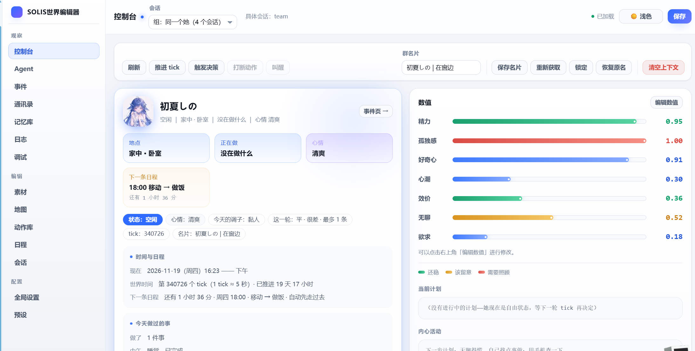

# 虚拟世界SOLIS

给 Bot 一个有空间、有作息、有记忆的生活状态机。

## 它是什么

SOLIS 是一个运行在 AstrBot 上的插件，接管白名单会话的回复。她不是一个换了一套说辞的应答器：世界时钟一直在走，她有自己的地图与位置、有自己的日程与作息、有会变化的身体状态和心情，也有按人归档的记忆。没有人和她说话的时候，她的生活照常继续；你开口时，她的回答建立在「此刻在哪、手头在做什么、心里挂着什么」之上。

插件安装简单，不引入额外 Python 依赖，首次启动会自动生成一套开箱即用的世界配置。

她做过的每件事都会留下记录，在编辑器里显示为可读的时间线。她想做什么、为什么在这个时刻开口、又为什么沉默，都可以事后核对。

## 特色

**她真的在过日子。** 走位、做饭、发呆、睡觉、翻记忆、上网查东西都按时间与状态发生。日程到点而地点不对，她会自己走过去；深夜困了会回卧室，精力不足会先歇一会儿。

**情绪会改变行为。** 精力、孤独感、好奇心、心潮、效价、无聊六项数值持续变化，影响她去哪儿、做什么、说不说话、说话时用什么语气。数值不是装饰，日志里能看到每一轮的选择依据。

**她记得住人。** 她会记住跟谁、在哪儿、聊过什么，也会记住这个人的关系、好感与不该碰的话题。同一个地方同一个人再来，她会想起来；被推翻的旧说法会作废，不会新旧混着讲。

**她会主动。** 按日程打招呼，遇到值得评论的事说一句，看到图片接一句话，挑一张表情包发出来。落在哪个会话由她当下在跟谁说话决定，私聊里的话不会出现在群里。

**她能动手办事。** 动作可以调用 AstrBot 里已安装的工具：生图、搜索、发语音、查天气都能成为她的动作。她也能领多步任务，把结果整理成产物交回来；中途缺信息时先用自己的世界知识回答，确实需要你拍板才会来问。

**群名片会跟着她走。** 她在哪个地点、在做什么，可以自动写进群名片。

**表情包是一套完整系统。** 收藏可以带描述与用法，按语义与关键词检索，每轮挑几张作为备选；发送前自动缩图，静态图转成 GIF 以适应客户端尺寸；整套收藏可以打包导出，在别处导入。

**一切都能看见。** 编辑器共 14 个页面：控制台、Agent、事件、通讯录、记忆库、日志、调试、素材、地图、动作库、日程、会话、全局设置、预设。

## 自定义

这是 SOLIS 投入最多的方向：除了核心的状态机，几乎每一层都开放给你改。

| 可以改什么 | 改到什么程度 |
| --- | --- |
| 人设与说话方式 | 角色卡、名字、性别、自称、称呼、声音样例、简易人设；人设来源可以切到 AstrBot 现有配置 |
| 世界 | 区域与地点自己增删改名，地点之间连线自己画，移动耗时自己定；也可以从一份世界扩建草案开始改 |
| 动作库 | 新建动作、改说明与参数、指定在哪些地点可用；动作可以是固定文案、让模型现场生成，或者调用某个工具 |
| 日程 | 时间点、频率（每天 / 每周 / 每月 / 间隔 / 标准 cron）、动作链、触发条件、到点后落在哪个会话 |
| 数值与阈值 | 初始值、上下限、触发阈值、衰减速度；六项数值的权重都可以调 |
| 记忆与关系 | 记忆上限、整理节奏、画像内容、好感与信任的显示方式；可以查看、编辑、删除单条记忆 |
| 表情包 | 收藏、名字、含义、什么时候用、什么时候别用；批量补描述，打包分享 |
| 会话 | 白名单、会话分组、临时会话规则；哪些群、哪些私聊由她接管 |
| 预设 | 一整套地图 + 动作 + 日程 + 白名单存成预设，随时切换；支持 JSON 导入导出 |
| 界面 | 状态面板显示哪些块、日志保留多久、调试信息给谁看 |

所有改动都会留下历史：每次保存、应用预设、优化人设之前，都会自动存一份当前配置，随时可以翻回去。

## 人设打磨

写人设不难，写到「像她」不容易，且本人深知本插件可配置内容繁多，用户有较大负担，插件为此准备了多种工具进行优化。

**设置向导。** 第一次使用会提供设置向导进行初步的配置：名字与角色卡、说话习惯、世界与作息、记忆与上下文，逐步完成。不必先读文档，也不必先理解所有选项。

**性格与习惯。** 一组直接对应观感的滑块：主动程度、群聊活跃度、句数、粘人程度，配合几个性格预设一键套用，无需直面满屏的设置参数。

**优化人设。** 把角色卡交给模型做一次体检，列出问题，并给出逐条改写建议。

**生成测评剧本。** 按她当前的人设生成一套多轮对话剧本，默认 20 轮。同一份剧本可以拿去跑不同模型或不同人设，直接比较「谁更像她」，而不是凭感觉换模型。

人设改完可以立刻在编辑器里观察一轮：她的称呼、语气、动作是否如你所愿。

## 安装

1. 通过asrtbot提供的插件市场安装本插件，或将 `astrbot_plugin_virtual_world` 目录放入 AstrBot 的 `data/plugins/`。
2. 重启 AstrBot，或者在插件管理中重载该插件。
3. 打开 AstrBot WebUI，进入插件详情页的「SOLIS世界编辑器」，按设置向导完成基本配置。

## 上手

1. 在插件配置中将要使用的模型等内容配置好
2. 在群聊/私聊中发送 `/vw session add`，把这个会话加入白名单。若想跨会话聊天，可以在编辑器中创建会话组，将多个会话添加到一个会话组中。
3. 打开编辑器的「全局设置」，在「她是谁」里填入名字与人设；暂时不想写角色卡，可以先用设置向导生成一版。
4. 在「地图」与「日程」页确认地点与时间安排。默认配置已经可用，可以先不改。
5. 在「动作库」看看她现在能做什么，按需增删。
6. 发送 `/vw status` 看她此刻在哪、在做什么、心情如何；在「日志」页读每一轮的原因。

## 与智能路由插件配合

推荐同时安装 `astrbot_plugin_vw_intent_router`（虚拟世界：意图路由）。
群聊里绝大多数消息并不是在跟 Bot 说话。该插件用一个独立的低成本模型判断每条消息值不值得回复，只把值得回的那部分交给主模型，并且按群的活跃程度自动收敛频率，避免频繁插话。

SOLIS 本身只处理白名单会话；两者叠加时，她什么时候开口由实际对话决定，而不是按固定间隔轮询。该插件可以单独使用，装了 SOLIS 之后它会读取她当前的状态，作为是否开口的依据之一。

## 常用命令

| 命令 | 用途 |
| --- | --- |
| `/vw status` | 她此刻在哪、在做什么、心情如何 |
| `/vw session add` / `remove` / `list` | 会话白名单管理 |
| `/vw map` | 查看地图与地点连通 |
| `/vw schedule` | 查看日程；`run <id>` 立即执行一条 |
| `/vw memory` | 查看她记得你什么 |
| `/vw recall <话题>` | 让她回忆某个话题 |
| `/vw forget me [话题]` | 让她忘记关于你的记忆 |
| `/vw event <一句话>` | 给她安排一件会发生的事，观察她如何应对 |
| `/vw debug state` | 打印当前完整状态 |
| `/vw reload` | 重新加载配置 |

管理类命令默认仅管理员可用，可以在「调试与安全」里调整。

## 常见问题

**她不说话。** 先确认这个会话已加入白名单（`/vw session list`），再看「说话与决策」里的主动程度与群聊活跃度。如果模型没有给出可用回复，日志里会写下原因。

**她不主动开口。** 主动行为由数值与日程驱动：孤独感低、无聊度低时她不会主动找人。可以调低触发阈值，或者在「日程」里加一条固定时间的日程。

**换了人设但不生效。** 检查「她是谁」里的人设来源。切到「用下面这一份」时改的是插件内的角色卡；切到 AstrBot 配置时改的是 AstrBot 那边。两边同时改会互相覆盖。

**图片没有被转述。** 图片转述需要一个支持图片输入的模型，在「高级功能」里指定。不支持的模型会在日志里留下失败原因，原图仍然照常附带。

**换模型后记忆要不要重建。** 不需要。记忆按结构化内容保存，换模型后旧记忆照常可用。

## 联系

问题反馈与使用交流：QQ 群 774141179。加群来玩叭!! 人好少啊!!
